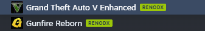

# HubcapUI Plugins

> [!WARNING]
> **Alpha software — expect bugs.** These plugins are in active development. Features may be incomplete or behave unexpectedly.

Independent plugins for [HubcapUI](https://github.com/oogiefied/HubcapUI).

| Plugin | DLL | Purpose |
| --- | --- | --- |
| RenoDX | `renodx.dll` | HDR mod discovery, installation, configuration, and removal. |
| OptiScaler | `optiscaler.dll` | Install and configure OptiScaler for supported games. |
| DLSS Suite | `dlsssuite.dll` | DLSSTweaks, dlssg-to-fsr3, and DLSS Enabler in one plugin, sharing a single Nexus API key entry. |

## RenoDX

RenoDX automatically detects supported games in your Steam library by matching them against the latest RenoDX compatibility list. Library badges make those games easy to spot; green badges show where RenoDX is enabled.



Right-click a compatible game in your Steam library and open **Manage → Enable RenoDX** for a one-click installation workflow. The plugin handles the RenoDX mod, the required ReShade build, and supported profile settings. Once installed, the same submenu offers **Remove RenoDX**.

Mods hosted exclusively on Nexus Mods or Discord may require an additional download step.

## OptiScaler

OptiScaler brings a similar one-click installation experience to any installed game. Right-click it in your Steam library and open **Manage → Enable OptiScaler** to start setup directly, without manually placing the OptiScaler files in the game folder.

## DLSS Suite

DLSS Suite merges what were three separate plugins — DLSSTweaks, dlssg-to-fsr3, and DLSS Enabler — into one, since all three install from Nexus Mods and previously required coordinating which plugin owned the shared Nexus API key UI. There's only one plugin now, so there's nothing to coordinate: a single **Set Nexus API Key** entry lives under DLSS Suite's own row in Hubcap Settings.

Each of the three is still an independent per-game install/remove toggle, available from a game's right-click **Manage** submenu in your Steam library as **DLSSTweaks**, **dlssg-to-fsr3**, and **DLSS Enabler** — the label switches to "Remove" once installed.

## Install

Download the DLLs you want from [Releases](https://github.com/YaBoi69er/HubcapUI-Plugins/releases/latest). Fully exit Steam, copy them into `Steam/hubcapui-plugins`, then restart Steam. Enable the plugin system and your selected plugins in Hubcap Settings, save, and restart when prompted.

## Automatic updates

**Moving from v0.1.1?** Install v0.1.2 manually once to switch to the renamed `YaBoi69er/HubcapUI-Plugins` update source. Later plugin releases can update automatically on a compatible host.

These plugins declare their own update source. A Hubcap host that implements the [plugin update standard](docs/plugin-updates.md) checks for stable GitHub releases in the background and installs verified DLLs before loading plugins on the next Steam restart. Plugin releases are independent of the main Hubcap DLL. Older hosts can continue using manual DLL installation.

The initial host support is being developed against upstream HubcapUI v1.0.9; installing a stock older host does not add the updater by itself.

RenoDX also refreshes its compatibility list from the RenoDX wiki; that is separate from updating the plugin DLL.

## Develop your own plugin

Start with the [Hello Hubcap template](examples/hello-hubcap/) and [plugin development guide](docs/plugin-development.md). They include the [native ABI v1 SDK](sdk/hubcap_plugin.h), an embedded manifest, a Library menu action, JSON commands, and a shared confirmation dialog. The example builds separately from RenoDX and OptiScaler.

```powershell
./scripts/test-plugin-template.ps1
```

This builds and checks the example DLL and its embedded UI without installing into Steam. See the guide for prerequisites, manual testing, and publishing plugins from your own repository.

## Build existing plugins

Use Windows x64, PowerShell 7, and Visual Studio C++ Build Tools with the Windows SDK:

```powershell
./build-all.ps1
```

Each plugin builds independently with `./scripts/build.ps1` from its directory. Outputs go in each plugin's `dist` folder. Only use `-Install` when Steam is fully stopped.

## Release

Set root `VERSION` and the RenoDX and OptiScaler embedded `src/plugin.json` and runtime versions to the same semantic version. Run `./scripts/verify-release.ps1`. Push a `vX.Y.Z` tag; the release workflow builds both DLLs and publishes them with dependency notices. The example template keeps its own version and is not published by this workflow. The updater uses GitHub's SHA-256 asset digests, not a mutable checksum file.

See [THIRD_PARTY_NOTICES.md](THIRD_PARTY_NOTICES.md) for bundled dependencies. RenoDX, ReShade, and OptiScaler game modifications are obtained separately by their respective plugins.
